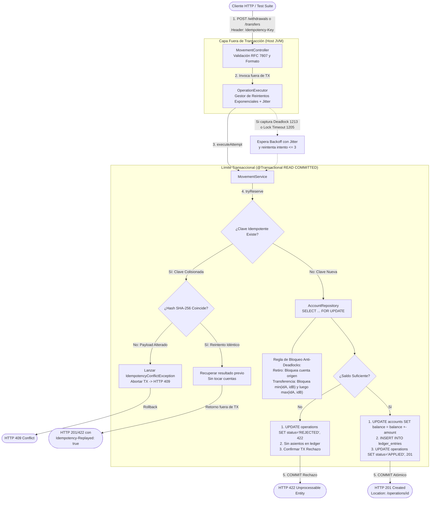
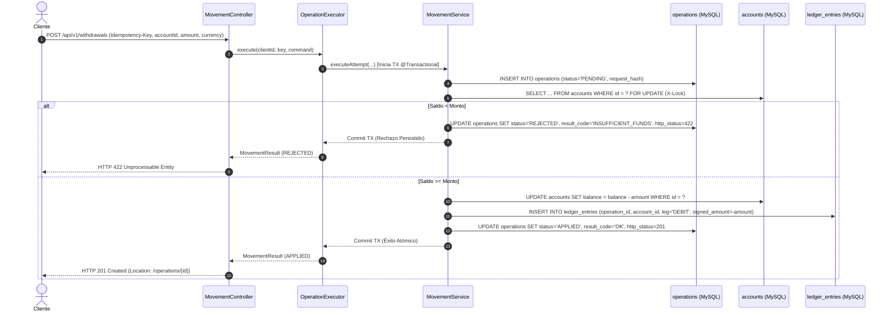
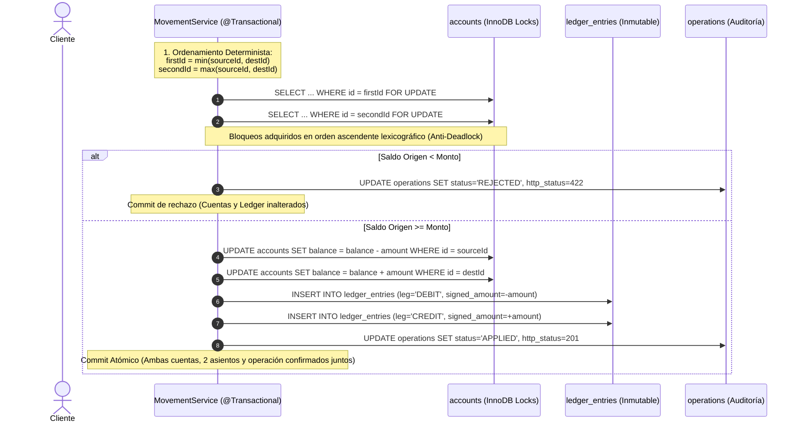

# Entregable 2: Diagrama de Flujo de Retiro y Transferencia con Límite Transaccional

Este documento describe la arquitectura de ejecución, las fronteras de aislamiento y el flujo detallado de retiro y transferencia con sus límites transaccionales explícitos.

---

## 1. Diagrama Global del Flujo y Límite Transaccional

El siguiente diagrama detalla la interacción desde la recepción HTTP hasta la confirmación física en base de datos. Se distingue explícitamente el límite de la transacción local de Spring (`@Transactional` sobre MySQL InnoDB) frente a la capa de reintentos y controladores.

---

## 2. Flujo Específico de Retiro de Fondos

En una operación de retiro (`POST /api/v1/withdrawals`), el límite transaccional involucra una sola cuenta bancaria:

---

## 3. Flujo Específico de Transferencia entre Cuentas

En una transferencia (`POST /api/v1/transfers`), el límite transaccional abarca la coordinación de dos cuentas garantizando la prevención de interbloqueos:

---

## 4. Garantías del Límite Transaccional

1. **Aislamiento `READ COMMITTED` + Locks Explícitos:** 
   - Evita lecturas sucias (*Dirty Reads*).
   - El bloqueo `FOR UPDATE` serializa a cualquier otra transacción que pretenda leer o escribir sobre la misma cuenta, eliminando actualizaciones perdidas (*Lost Updates*).
2. **Atomicidad Todo o Nada:**
   - Si la aplicación experimenta una desconexión o fallo en la mitad de la transferencia (por ejemplo, tras debitar el origen pero antes de acreditar el destino), el motor InnoDB revierte automáticamente todos los cambios del intento.
3. **Reintentos Fuera de Transacción:**
   - La clase `OperationExecutor` se sitúa estrictamente **fuera** de la demarcación transaccional. Ante un error transitorio de contención (`DeadlockLoserDataAccessException` o `CannotAcquireLockException`), la transacción fallida se descarta por completo y se reabre una nueva conexión y transacción con backoff exponencial.
