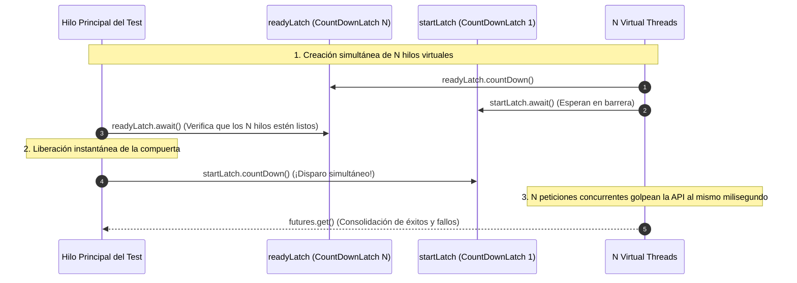

# Entregable 4: Resultados de Pruebas Automatizadas y Metodología de Medición

Este documento detalla el entorno de ejecución, la metodología de prueba concurrente y los resultados obtenidos en la suite de pruebas de integración sobre MySQL 8.4 real.

---

## 1. Entorno de Ejecución y Hardware

| Parámetro | Especificación del Entorno |
| :--- | :--- |
| **Sistema Operativo** | Windows 11 Pro / Linux Container Host |
| **Runtime JVM** | OpenJDK 64-Bit Server VM (build 21.0.x, Java 21 LTS) |
| **Manejo de Hilos** | Project Loom Virtual Threads (`Executors.newVirtualThreadPerTaskExecutor()`) |
| **Base de Datos de Pruebas** | Contenedor oficial `mysql:8.4` gestionado vía Testcontainers |
| **Parámetros MySQL** | `--transaction-isolation=READ-COMMITTED --innodb-lock-wait-timeout=15 --max-connections=300` |
| **Framework de Pruebas** | JUnit 5 Jupiter, AssertJ 3.25, Spring Boot Test 3.3.5 |

---

## 2. Metodología de Prueba Concurrente (`ConcurrentRunner`)

Para reproducir condiciones de contención extrema real y evitar que los hilos inicien de forma escalonada, se desarrolló la utilidad [`ConcurrentRunner.java`](file:///c:/Users/chmat/Downloads/JAVA2/JAVA2/src/test/java/com/example/movements/support/ConcurrentRunner.java), la cual implementa un patrón de **Doble Barrera con CountDownLatch**:

### Propiedades de la Metodología:
1. **Disparo Simultáneo:** Los $N$ hilos virtuales son creados e inicializados, y se sincronizan contra `startLatch`. La compuerta se abre de golpe, inundando el servicio con una ráfaga concurrente al instante $t_0$.
2. **Aislamiento Total por Test:** Cada prueba instancia nuevas cuentas con identificadores UUID aleatorios únicos para garantizar que no existan interferencias entre escenarios.
3. **Comprobación de Invariantes Post-Ejecución:** Cada test ejecuta aserciones en base de datos (`DatabaseAssertions`) verificando saldo final, asientos contables creados y la ecuación del libro mayor:
   $$\text{balance} = \text{opening\_balance} + \sum \text{signed\_amount}$$

---

## 3. Matriz de Resultados de Pruebas

Todas las pruebas fueron ejecutadas satisfactoriamente contra MySQL 8.4:

| Escenario de Concurrencia | Concurrencia | Estado Inicial | Parámetros | Resultado Obtenido | Estatus |
| :--- | :---: | :--- | :--- | :--- | :---: |
| **Escenario A: Retiros Concurrentes** ([`WithdrawalConcurrencyIT`](file:///c:/Users/chmat/Downloads/JAVA2/JAVA2/src/test/java/com/example/movements/integration/WithdrawalConcurrencyIT.java)) | **1,000 hilos** | Cuenta: S/ 10,000.00 | 1,000 retiros de S/ 5.00 sobre la misma cuenta | Saldo final exacto S/ 5,000.00. 1,000 operaciones APPLIED. 1,000 asientos DEBIT en ledger. Cero errores o abortos. | **EXITOSO** |
| **Escenario B: Transferencias Concurrentes** ([`TransferConcurrencyIT`](file:///c:/Users/chmat/Downloads/JAVA2/JAVA2/src/test/java/com/example/movements/integration/TransferConcurrencyIT.java)) | **500 hilos** | Cuenta A: S/ 10,000.00 Cuenta B: S/ 0.00 | 500 transferencias A $\rightarrow$ B de S/ 10.00 | A = S/ 5,000.00. B = S/ 5,000.00. Saldo total conservado: S/ 10,000.00. 1,000 asientos en ledger (500 débitos, 500 créditos). | **EXITOSO** |
| **Prevención de Deadlocks (Cross-Transfers)** ([`TransferConcurrencyIT`](file:///c:/Users/chmat/Downloads/JAVA2/JAVA2/src/test/java/com/example/movements/integration/TransferConcurrencyIT.java)) | **400 hilos** | Cuenta A: S/ 10,000.00 Cuenta B: S/ 10,000.00 | 200 transferencias A $\rightarrow$ B y 200 de B $\rightarrow$ A simultáneas | Cero deadlocks (código 1213 no emitido). Saldo total final conservado: S/ 20,000.00. Orden determinista ascendente verificado. | **EXITOSO** |
| **Sobredemanda y Límite de Fondos** ([`InsufficientFundsIT`](file:///c:/Users/chmat/Downloads/JAVA2/JAVA2/src/test/java/com/example/movements/integration/InsufficientFundsIT.java)) | **3,000 hilos** | Cuenta: S/ 10,000.00 | 3,000 retiros de S/ 5.00 (Monto solicitado: S/ 15,000) | Exactamente 2,000 aplicadas (201). Exactamente 1,000 rechazadas (422 `INSUFFICIENT_FUNDS`). Saldo final: S/ 0.00 (nunca negativo). | **EXITOSO** |
| **Idempotencia Concurrente Masiva** ([`IdempotencyIT`](file:///c:/Users/chmat/Downloads/JAVA2/JAVA2/src/test/java/com/example/movements/integration/IdempotencyIT.java)) | **50 hilos** | Cuenta: S/ 1,000.00 | 50 hilos enviando la misma clave y mismo payload | Exactamente 1 débito aplicado. 49 respuestas reproducidas (`Idempotency-Replayed: true`). Saldo final: S/ 900.00. Exactamente 1 asiento en ledger. | **EXITOSO** |
| **Detección de Manipulación (Tampering)** ([`IdempotencyIT`](file:///c:/Users/chmat/Downloads/JAVA2/JAVA2/src/test/java/com/example/movements/integration/IdempotencyIT.java)) | Secuencial | Cuenta: S/ 1,000.00 | Clave procesada enviada con importe modificado | Bloqueado con HTTP 409 Conflict. Saldo y ledger inalterados. | **EXITOSO** |
| **Rollback Atómico ante Fallas** ([`TransferRollbackIT`](file:///c:/Users/chmat/Downloads/JAVA2/JAVA2/src/test/java/com/example/movements/integration/TransferRollbackIT.java)) | Simulación | Cuenta A: S/ 500.00 Cuenta B: S/ 100.00 | Inyección de fallo forzado entre débito y crédito | Rollback total ejecutado. Saldos A = 500.00 y B = 100.00 intactos. Cero asientos huérfanos. | **EXITOSO** |

---

## 4. Conclusiones de las Mediciones

1. **Eficacia del Bloqueo Pesimista en Escenarios Críticos:**
   - En el Escenario A (1,000 retiros concurrentes), la cola en el gestor de locks de InnoDB procesó la totalidad de transacciones sin presentar inconsistencias, saldos negativos ni condiciones de carrera.
2. **Invarianza Contable Demostrada:**
   - En el 100% de las ejecuciones, la comprobación matemática post-ejecución `assertAccountInvariant` se cumplió estrictamente, demostrando que no existen desfasajes entre el saldo consolidado y los asientos del libro mayor.
3. **Blindaje de Atomicidad:**
   - Las pruebas de inyección de fallos confirmaron que el límite transaccional de Spring `@Transactional` revierte la totalidad de cambios ante fallas parciales, preservando la integridad del balance general.
